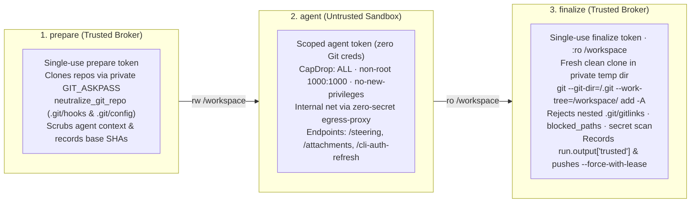

# Security Policy & Threat Model

## Supported Versions

Security updates are applied to the latest release of GitSeed on the `main` branch.

| Version | Supported          |
| ------- | ------------------ |
| 0.1.x   | :white_check_mark: |

## Reporting a Vulnerability

Please **do not** report security vulnerabilities through public GitHub issues, discussions, or pull requests.

Instead, report sensitive security issues privately via **[GitHub Private Vulnerability Reporting](https://github.com/gitseed-dev/gitseed/security/advisories/new)** (or by emailing **security@gitseed.dev** if you are unable to use GitHub advisories).

When reporting a vulnerability, please include:

- A description of the issue and affected component (`apps/core`, `apps/runner`, `apps/web`, `apps/cli`, `apps/mcp`, or `charts/gitseed`).
- Steps to reproduce or a proof-of-concept exploit.
- Any relevant configuration details (Docker vs. Kubernetes compute backend, auth mode, etc.).

We will acknowledge receipt within 48 hours and work with you to validate, patch, and disclose the issue responsibly.

---

## Threat Model & Trust Boundaries

GitSeed orchestrates autonomous coding CLIs (`opencode`, `claude-code`, `codex`, `antigravity`, `gemini`, `grok-build`) that execute arbitrary shell commands and untrusted repository code inside containers. Because a repository, dependency, issue body, or pull request comment can contain prompt injections or malicious build scripts, **GitSeed treats the coding agent container and its `/workspace` filesystem as untrusted**.

### 1. Core Security Invariant: "Untrusted Agent, Trusted Broker"

Every stage execution is split across **three isolated container phases** (`prepare` → `agent` → `finalize`) orchestrated by the Control Plane scheduler, each issued a cryptographically scoped, phase-specific run token:

1. **`prepare` (Trusted Broker — single-use `prepare` token)**:
   - Exchanges its single-use `prepare` token at `GET /api/v1/runner/context` (immediately invalidating the token for repeat context fetches) and stores trusted broker metadata in `/gitseed-secrets` (which is never mounted into the `agent` container), writing only credential-scrubbed metadata (`scrub_context_for_agent`) to `/gitseed-ctl`.
   - **Hostile Repository & `.git/hooks` Neutralization (`neutralize_git_repo` & `run_safe_git`)**: Before running *any* `git` command against a warm or freshly cloned workspace, `neutralize_git_repo` unlinks symlinked/non-directory `.git` entries, removes stale `*.lock` files, deletes and recreates `.git/hooks` as an empty directory, removes `.git/info/attributes` and `.git/info/grafts`, and overwrites `.git/config` from scratch (`hooksPath = /dev/null`, `fsmonitor = false`, stripped origin URL) without parsing any existing untrusted config. Every `git` subprocess runs via `run_safe_git` with `GIT_CONFIG_NOSYSTEM=1`, `GIT_CONFIG_GLOBAL=/dev/null`, `GIT_TERMINAL_PROMPT=0`, and mandatory `-c core.hooksPath=/dev/null -c core.fsmonitor=false -c protocol.ext.allow=never -c core.sshCommand=ssh`.
   - Clones/fetches target repositories via private `GIT_ASKPASS` scripts and records each repository's authoritative `base_sha` and `remote_seed_heads` via `POST /api/v1/runner/prepare-complete`.
2. **`agent` (Untrusted Sandbox — scoped `agent` token)**:
   - Runs the coding CLI (`opencode`, `claude-code`, `codex`, `gemini`, `antigravity`, `grok-build`) inside a hardened non-root container (`1000:1000`, `CapDrop: ALL`, `no-new-privileges:true`, PIDs limit, memory/CPU limits).
   - **Zero Git or Finalize Credentials**: The `agent` container never receives Git tokens, `GITSEED_SECRET_KEY`, LiteLLM master keys, `/gitseed-secrets`, or `prepare`/`finalize` tokens.
   - **Narrow Internal API Surface**: An `agent` token can only access `/api/v1/runner/steering`, `/api/v1/runner/attachments/{attachment_id}`, and `/api/v1/runner/cli-auth-refresh` (which strictly validates credential file paths and sizes against an allowlist of known CLI config paths and rejects symlinks, path traversal, and world-readable modes).
   - Even if the agent (or a malicious build/test script) plants trojaned `.git/hooks/*`, `.git/config` directives, nested `.git` directories, forged commit history, or fake `output.json` telemetry inside `/workspace`, those artifacts are **never trusted** for policy enforcement or Git pushes.
3. **`finalize` (Trusted Broker — single-use `finalize` token, `:ro` workspace mount)**:
   - Before returning `GET /api/v1/runner/finalize-context`, the Control Plane explicitly stops/verifies termination of the untrusted `agent` container so no process can mutate `/workspace` while `finalize` inspects it. `finalize` mounts `/workspace` **read-only (`:ro`)**, fetches trusted repository metadata (`base_heads`, `blocked_paths`), and requests single-use per-repository push credentials from `POST /api/v1/runner/git-push-token`.
   - Clones a fresh, clean copy of each target repository into a private `/tmp/gitseed-finalize-*` directory outside `/workspace` and checks out the recorded `base_sha`.
   - Rejects any unauthorized nested `.git` directories or `160000` submodule gitlinks not present in `base_sha`, stages changes directly from the read-only `/workspace/<repo>` tree into the clean `.git` index via `git --git-dir=<clean>/.git --work-tree=/workspace/<repo> add -A`, and unstages internal metadata (`.gitseed`, `opencode.json`, `.gitseed-worktrees`; runtime configs such as `OPENCODE_CONFIG` are written outside `/workspace`) — **never executing or reading `.git/hooks`, `.git/config`, or git objects inside `/workspace`**.
   - **Server-Grade Policy, Size & Secret Enforcement**: Inspects the staged `git diff --cached` against policy `blocked_paths` globs (default mode `fail`, which aborts before commit/push; `revert` mode optionally restores matched paths to `base_sha`), enforces per-file (`5 MiB`) and total diff (`20 MiB`) byte caps, and scans all added lines (`+`) for high-confidence secret patterns (AWS keys, GitHub/GitLab PATs, Anthropic/OpenAI keys, Slack tokens, PEM private keys, and literal issued run credentials).
   - Pushes the verified commit to `gitseed/<project>/seed-<N>` via a private `GIT_ASKPASS` script and `--force-with-lease=refs/heads/<branch>:<expected_remote_sha>`, and submits the authoritative `trusted` report to `POST /api/v1/runner/complete`, which persists `run.output["trusted"]` and attaches an Ed25519-signed **Governance Receipt** to the pull request.

---

### 2. Enforced vs. Estimated Controls

GitSeed explicitly labels which security and governance controls are cryptographically or broker-enforced versus estimated or agent-reported:

| Control | Classification | Enforcement Mechanism & Trust Boundary |
| :--- | :--- | :--- |
| **Spend Caps in API-Key / LiteLLM Mode** | **Enforced** (`budget_enforcement: "enforced"`) | The scheduler provisions a per-run scoped LiteLLM virtual key with `max_budget = min(monthly_remaining, seed_cap_remaining, checkpoint_remaining)`. The LiteLLM proxy hard-rejects inference requests once the dollar ceiling is reached. |
| **Spend Caps in Personal Mode (Subscription OAuth)** | **Estimated** (`budget_enforcement: "estimated"`) | Subscription CLIs communicate directly with vendor OAuth endpoints rather than LiteLLM virtual keys. Spend is **estimated** post-run from CLI token telemetry and bounded during execution by broker-enforced wall-clock container timeouts (`timeout_minutes`) and CLI turn limits (`--max-turns` where supported natively by the CLI, such as `claude-code`). |
| **`blocked_paths` & Secret Scanning** | **Enforced** | Evaluated by the trusted `finalize` container against a clean `.git` index with `/workspace` mounted `:ro` *before* any commit is created or pushed to the remote Git host. |
| **In-Container Test / Verification Commands** | **Agent-Reported** (`source: "agent_reported"`) | Test suites executed during the `agent` phase run inside the untrusted workspace and are labeled `source: "agent_reported"` in receipts. High-assurance workflows pair in-container tests with external Git-host CI status checks (`auto_remediate_ci`) and branch protection. |
| **Governance Receipts (`gitseed.receipt.v1`)** | **Enforced / Ed25519-Signed** | Canonical JSON provenance record compiled by the Control Plane from `run.output["trusted"]`, locked specs, and human `SeedApproval` records, signed with the control plane's Ed25519 private key (`GET /api/v1/receipts/public-key`, `GET /api/v1/seeds/{id}/receipt`). Supports completely offline verification against a pinned PEM key via `gitseed receipt verify <receipt.json> --public-key-file <pubkey.pem>` (`-k`), verifying canonical JSON integrity, SHA-256 `key_id` binding, and Ed25519 signature without trusting unverified embedded keys. |

---

### 3. Network, Host & Proxy Isolation

- **Docker Socket Isolation (`docker-socket-proxy`) & Numeric Non-Root Containers**: Neither `api` nor `scheduler` mounts `/var/run/docker.sock` directly; container lifecycle calls traverse an internal `gitseed-docker-proxy` network through a restricted `docker-socket-proxy` (`CONTAINERS=1`, `EXEC=1`, `NETWORKS=1`, `VOLUMES=1`, `IMAGES=1`, `INFO=1`, `POST=1`, while blocking `PRIVILEGED`, `HOST`, `SWARM`, `SECRETS`, and `SYSTEM`). Control-plane images and Kubernetes Deployments enforce numeric `USER 1000:1000` (`runAsNonRoot: true`, `runAsUser: 1000`, `runAsGroup: 1000`, `allowPrivilegeEscalation: false`), and spawned runner/sandbox containers enforce `no-new-privileges:true`, `cap_drop: ["ALL"]`, and `pids_limit`.
- **Zero-Secret SSRF-Hardened `egress-proxy` & Network Segmentation**: Runner (`gitseed-runners`) and interactive sandbox (`gitseed-sandboxes`) networks are marked `internal: true` with no direct internet route. Outbound HTTP/HTTPS traffic traverses `egress-proxy`, which runs **without** control-plane secrets (`GITSEED_SECRET_KEY`, `POSTGRES_PASSWORD`, `LITELLM_MASTER_KEY`), enforces strict request-line/header byte bounds, resolves target hostnames via DNS, connects directly to verified public IPs on allowed ports (preventing DNS rebinding), and blocks RFC1918 private networks (`10.0.0.0/8`, `172.16.0.0/12`, `192.168.0.0/16`), loopback (`127.0.0.0/8`, `::1`), and cloud metadata (`169.254.169.254`). In Docker Compose, `EGRESS_INTERNAL_HOSTS` is port-scoped (`litellm:4000,api:8420`) so internal PostgreSQL (`5432`), Valkey (`6379`), and `docker-socket-proxy` (`2375`) ports remain unreachable even across shared internal networks.
- **Port `8423` Cookie-Less `SANDBOX_ORIGIN` Isolation for Embedded VS Code (`openvscode-server`)**: The main Web UI Caddy listener (`:8421`) rejects `/api/v1/vscode/*` with `403 Forbidden` so container webviews can **never** run on the `gitseed_session` cookie origin. A dedicated second listener (`:8423`, `SANDBOX_ORIGIN=http://127.0.0.1:8423`) handles **only** `/api/v1/vscode/*` (`404` on all other paths) and strips control-plane `gitseed_session` and `gitseed_csrf` cookies at the Caddy edge, while `session_vscode.py` enforces `Origin` and `Host` matching against `SANDBOX_ORIGIN`, authenticates sessions via HMAC-derived tokens, strips all `Cookie`/`Authorization`/`Set-Cookie` headers before forwarding upstream into the container, and sets `X-Frame-Options: SAMEORIGIN` and `Content-Security-Policy: frame-ancestors 'self'`.
- **MCP Server Protection (`127.0.0.1` Bind + `Bearer` Auth + `Origin` Validation)**: In Docker Compose, `mcp` binds exclusively to loopback (`127.0.0.1:8422` via `MCP_BIND_HOST`) and is isolated from `gitseed-runners` so untrusted runner containers cannot reach it. Over Streamable HTTP (`/mcp`) and SSE (`/sse`), the MCP server validates the `Origin` header to block browser DNS-rebinding / cross-origin attacks, requires `Authorization: Bearer gsp_...` PAT authentication for control-plane operations, and isolates `Mcp-Session-Id` state per caller token so sessions can never inherit another user's credentials.
- **WebSocket Origin & CSRF Enforcement + Short-Lived SSE Tokens**: Interactive PTY WebSockets validate the browser `Origin` header against `ALLOWED_ORIGINS`, while state-mutating cookie-authenticated HTTP requests require the `X-GitSeed-CSRF` header. EventSource streams use short-lived (60-second), single-purpose `gssse_` stream tokens (`POST /api/v1/events/stream-token`) so long-lived PATs or session tokens never appear in URL query strings.
- **Local Git Smart HTTP Hardening**: Built-in local bare repositories validate all refnames via `git check-ref-format`, scope workspace roots via `LOCAL_WORKSPACE_ROOTS` (`/workspaces` in Docker Compose), disable `receive.denyCurrentBranch`, and execute `post-receive` working-tree sync hooks with sanitized environments (`GIT_CONFIG_NOSYSTEM=1`) and explicit `--git-dir` / `--work-tree` flags.
- **Fail-Closed Startup Secrets & Authenticated State Stores**: Unless `GITSEED_ALLOW_INSECURE_DEFAULTS=true` (non-production only), the Control Plane refuses to boot if `GITSEED_SECRET_KEY`, `POSTGRES_PASSWORD`, or `LITELLM_MASTER_KEY` are missing, weak, or set to known defaults. Helm deployments enable Valkey `--requirepass` authentication automatically, annotate generated Secrets with `"helm.sh/resource-policy": keep`, and support `gitops.requireExistingSecret=true` so ArgoCD/Flux pipelines never rotate `GITSEED_SECRET_KEY` on sync.

---

### 4. Known Residual Risks

1. **Per-Project Dependency Cache Volume**: To keep container cold-starts fast, runs within the same project share a read-write package cache volume (`/home/runner/.cache/packages`, `gitseed-pkg-cache-prj_<id>`). While isolated across different projects, a compromised run in Project A could poison cached build artifacts consumed by a subsequent run in Project A. High-sensitivity environments can disable shared package caching per project or run ephemeral Kubernetes Jobs with emptyDir volumes.
2. **In-Container Verification Runs in the Agent Sandbox**: Because unit test suites execute inside the `agent` container during the `Execute` stage, a malicious agent could report a synthetic zero exit code. GitSeed marks in-container verification as `source: "agent_reported"` in Governance Receipts and recommends requiring external GitHub Actions / GitLab CI checks (`auto_remediate_ci`) before merging.
3. **Personal Mode (`cli_oauth`) Consumer Terms & Telemetry**: Personal Mode encrypts single-user CLI OAuth credentials and enforces strict single-user ownership (`owner_user_id` — non-owners cannot bind, dispatch, or inspect another user's Personal Mode backend, multi-user orgs disable Personal Mode unless `ALLOW_PERSONAL_MODE_IN_MULTI_USER_ORGS=true`, and organizations can disable it globally via `GITSEED_ALLOW_PERSONAL_CLI_OAUTH=false`). Because subscription CLIs communicate directly with vendor endpoints, token spend is estimated rather than hard-capped by LiteLLM, and usage remains subject to each vendor's consumer terms of service.
4. **`docker-socket-proxy` vs. Kubernetes Isolation**: In Docker Compose deployments, `docker-socket-proxy` avoids mounting raw `/var/run/docker.sock` into `api` or `scheduler` and blocks `PRIVILEGED`, `HOST`, `SWARM`, and `SYSTEM` endpoints, while spawned containers run unprivileged (`1000:1000`, `CapDrop: ALL`, `no-new-privileges`). However, because container and volume creation (`CONTAINERS=1`, `VOLUMES=1`, `POST=1`) are required on the Docker API, `docker-socket-proxy` protects against accidental misuse rather than a fully compromised Control Plane process. Multi-tenant or high-assurance production deployments should use the **Kubernetes compute backend** (with namespace isolation, RBAC, `NetworkPolicy`, and Pod Security `restricted` / gVisor / Kata runtime classes) or rootless Docker.
5. **TLS `CONNECT` Tunneling to Allowlisted Public Hosts**: While `egress-proxy` blocks RFC1918 private networks, loopback, cloud metadata (`169.254.169.254`), and unapproved external domains, outbound HTTPS `CONNECT` tunnels to allowlisted hosts (e.g., `api.anthropic.com`, `api.openai.com`, `pypi.org`, `registry.npmjs.org`, `api.github.com`) are end-to-end TLS-encrypted and cannot be L7 payload-inspected without a corporate TLS-intercepting proxy. Deployments with strict data-loss prevention (DLP) requirements should set `EGRESS_ALLOWLIST` exclusively to internal package mirrors and internal LLM gateways (such as LiteLLM / Ollama / vLLM).

---

### 5. Adversarial Verification ("Evil Agent" Red-Team Suite)

GitSeed's trust boundary is continuously verified against simulated compromised agents in automated test suites:

- **[`apps/core/tests/test_evil_agent_redteam.py`](./apps/core/tests/test_evil_agent_redteam.py)**: Red-team regression suite simulating an adversarial `agent` container attempting to:
  - Replay or forge `prepare` / `finalize` tokens or call `/finalize` with an `agent` token.
  - Modify protected files matching `blocked_paths` (`.github/workflows/ci.yml`, `.env.production`) or plant trojaned `.git/hooks/pre-commit`, nested `.git` directories, and `.git/config` `core.fsmonitor` payloads inside `/workspace`.
  - Commit leaked AWS/GitHub/OpenAI secrets or issued run tokens to the working tree.
  - Exfiltrate arbitrary files or symlinks via `/cli-auth-refresh` path traversal.
  - Spoof `run.output["trusted"]` fields via `output.json` or tamper with an Ed25519-signed `gitseed.receipt.v1` Governance Receipt or forge an untrusted `public_key_pem`.
  - Cross-use another user's Personal Mode (`cli_oauth`) backend or connect to cloud metadata (`169.254.169.254`) / internal RFC1918 addresses through `egress-proxy`.
- **[`apps/core/tests/test_postgres_scheduler_integration.py`](./apps/core/tests/test_postgres_scheduler_integration.py)**: End-to-end PostgreSQL concurrency (`FOR UPDATE SKIP LOCKED`), stale container reconciliation, and stage state-machine integration tests.
