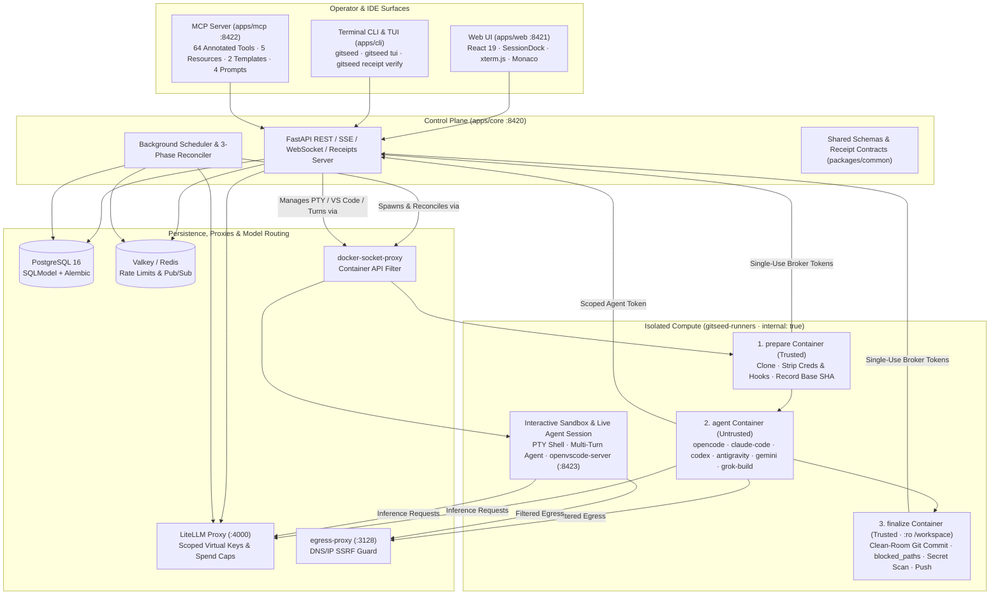

# GitSeed Architecture

GitSeed is a self-hosted, vendor-neutral control plane for AI software engineering. It turns software requirements (**Seeds**) into reviewed, merge-ready pull requests by orchestrating coding agents inside isolated 3-phase Docker or Kubernetes sandboxes (`prepare` → `agent` → `finalize`) with broker-enforced guardrails, Ed25519-signed **Governance Receipts**, parallel 3-model **Second Opinions**, and human approval gates.

For a domain overview of GitSeed's five core nouns (**Project**, **Seed**, **Run**, **Policy**, **Agent**), see [**`docs/concepts.md`**](./concepts.md). For the full threat model and trust-boundary invariants, see [**`SECURITY.md`**](../SECURITY.md).

---

## 1. System Topology & Trust Boundaries

---

## 2. The 3-Phase Broker Execution Architecture (`prepare` → `agent` → `finalize`)

To prevent a prompt-injected or compromised coding CLI from exfiltrating Git credentials, tampering with `.git/hooks`, bypassing `blocked_paths`, or forging verification output, every stage run is split across three isolated containers sharing a run-specific `/workspace` volume:

1. **Phase 1: `prepare` (Trusted Broker — single-use `prepare` token)**:
   - Exchanges its single-use `prepare` token at `GET /api/v1/runner/context` for short-lived repository clone credentials.
   - Clones or fetches target repositories into `/workspace`, strips credentials from `.git/config`, neutralizes `.git/hooks` and dangerous `.git/config` directives (`core.fsmonitor`, `core.sshCommand`, `core.hooksPath`, `protocol.ext.allow`), and records each repo's `base_sha` with the Control Plane via `POST /api/v1/runner/prepare-complete`.
2. **Phase 2: `agent` (Untrusted Sandbox — scoped `agent` token)**:
   - Runs as non-root (`1000:1000`) with `CapDrop: ALL`, `no-new-privileges:true`, and zero Git credentials or `prepare`/`finalize` tokens.
   - Attached to the internal `gitseed-runners` network; outbound HTTPS requests pass through `egress-proxy`, which resolves DNS and blocks RFC1918 private networks, loopback, and cloud metadata (`169.254.169.254`).
   - Can only call `/api/v1/runner/steering`, `/api/v1/runner/attachments/{id}`, and the path-allowlisted `/api/v1/runner/cli-auth-refresh` endpoint on the Control Plane.
3. **Phase 3: `finalize` (Trusted Broker — single-use `finalize` token, `:ro` `/workspace` mount)**:
   - Mounts `/workspace` **read-only (`:ro`)** and fetches trusted finalize context via `GET /api/v1/runner/finalize-context` and single-use push credentials via `POST /api/v1/runner/git-push-token`.
   - Clones a fresh, clean copy of each repository into a private `/tmp/gitseed-finalize-*` directory outside `/workspace` and stages changes from `/workspace/<repo>` via `git --git-dir=<clean>/.git --work-tree=/workspace/<repo> add -A` — never executing or trusting the agent's `.git` directory, hooks, or history.
   - Enforces policy `blocked_paths` (`fail` by default, or `revert`) and scans added diff lines (`+`) for leaked secrets before committing and pushing via `GIT_ASKPASS` and `--force-with-lease`.
   - Reports authoritative diff stats, commit SHAs, `blocked_paths` status, and secret scan results to `POST /api/v1/runner/complete`, which persists `run.output["trusted"]`.

---

## 3. The 5-Stage SDLC State Machine & Governance Receipts

Every **Seed** progresses through five structured stages (`Ideate → Plan → Execute → Review → Merge`) governed by organization defaults and per-project [`Policy`](../apps/core/src/gitseed_core/models/policy.py) overrides:

1. **Ideate (`@ideator`)**:
   - Refines problem scope, edge cases, and testable acceptance criteria (`IdeateStageOutput`).
   - **Spec Locking**: Once `Ideate` is approved, `seed.specification` is locked so downstream stages execute against an agreed contract.
2. **Plan (`@planner`)**:
   - Decomposes the locked specification into ordered [`SeedTask`](../apps/core/src/gitseed_core/models/seed.py) items and identifies target repositories (`PlanStageOutput`).
3. **Execute (`@coder`)**:
   - Executes across the 3-phase `prepare` → `agent` → `finalize` pipeline, opens or updates pull requests on GitHub, GitLab, or Bitbucket (`ExecuteStageOutput`), and posts an Ed25519-signed **Governance Receipt** comment on the PR.
   - **In-Container Parallel Sub-Worktrees ([`git_ops.py`](../apps/runner/src/gitseed_runner/git_ops.py))**: When planned tasks touch disjoint target file sets (`tasks_have_disjoint_targets`), the runner provisions isolated `git worktree` checkouts inside `/workspace`, executes those tasks concurrently, and merges them back into the working tree prior to `finalize`.
4. **Review (`@reviewer`)**:
   - Audits branch diffs against the locked specification, task plan, and test results (`ReviewStageOutput`).
   - Supports human **Approve**, **Request Changes**, or **Inline File/Line Diff Review Annotations** (`SeedChangesTab`) that bundle line-specific notes into a structured `@coder` remediation task.
5. **Merge (`@merger`)**:
   - Confirms upstream approvals and branch readiness (`MergeStageOutput`), refreshes the signed Governance Receipt with final approval records, and merges the remote pull request upon human sign-off.

### Ed25519-Signed Governance Receipts (`gitseed.receipt.v1`)

The Control Plane compiles a canonical `GovernanceReceipt` ([`services/receipts.py`](../apps/core/src/gitseed_core/services/receipts.py)) from server-verified `run.output["trusted"]` telemetry, locked specifications, spend records (`enforced` vs. `estimated`), and human stage approvals, signing the canonical JSON payload with an Ed25519 private key. Operators and CI pipelines can fetch and verify receipts via `GET /api/v1/seeds/{id}/receipt`, `GET /api/v1/receipts/public-key`, or `gitseed receipt verify <receipt.json> --public-key-file <pubkey.pem>`.

---

## 4. Multi-Runtime Execution, Personal Mode & Spend Guardrails

- **Pluggable CLI Adapters ([`apps/runner/src/gitseed_runner/adapters.py`](../apps/runner/src/gitseed_runner/adapters.py))**:
  - Normalizes invocation, model selection, session continuation (`--continue` / `--resume`), and token usage parsing across `opencode`, `claude-code`, `codex`, `antigravity`, `gemini`, and `grok-build`.
- **Enforced vs. Estimated Spend Controls**:
  - **API / LiteLLM Mode (`budget_enforcement: "enforced"`)**: The scheduler provisions an ephemeral LiteLLM virtual key for each run whose `max_budget` is hard-capped at `min(monthly_remaining, seed_cap_remaining, checkpoint_remaining)`.
  - **Personal Mode — Single-User Subscription CLI OAuth (`budget_enforcement: "estimated"`, [`services/cli_auth.py`](../apps/core/src/gitseed_core/services/cli_auth.py))**: Individual operators authenticate their own subscription once inside a temporary container (`claude setup-token`, `codex login`, Google OAuth). The encrypted bundle is strictly bound to `owner_user_id` (single-user only; toggleable via `GITSEED_ALLOW_PERSONAL_CLI_OAUTH`). Because vendor CLIs talk directly to provider OAuth endpoints, USD spend is **estimated** from CLI token telemetry and bounded during execution by broker-enforced container wall-clock timeouts (`timeout_minutes`) and `--max-turns`.
- **Live `@agent` Steering**:
  - When an operator posts an `@agent` comment during an active run, the runner debounces the feedback and resumes the native CLI session in place so the agent incorporates the guidance without losing context.

---

## 5. Interactive Sandboxes & Live Agent Sessions

Alongside autonomous stage runs, GitSeed provides interactive container environments accessible from the Web UI's persistent `SessionDock`, the `gitseed` CLI, and the MCP server:

- **Live Agent Sessions ([`services/agent_sessions.py`](../apps/core/src/gitseed_core/services/agent_sessions.py))**: Multi-turn interactive coding conversations with `@coder`, `@ideator`, `@planner`, or custom agents inside a live container workspace, with 1-click promotion of uncommitted changes or proposed specs into a governed Seed.
- **Browser PTY Terminals ([`services/session_pty.py`](../apps/core/src/gitseed_core/services/session_pty.py))**: Multiplexed WebSocket PTY streaming (`tmux`-backed) into `@xterm/xterm`, protected by WebSocket `Origin` and CSRF validation.
- **Embedded VS Code Web ([`services/session_vscode.py`](../apps/core/src/gitseed_core/services/session_vscode.py))**: On-demand `openvscode-server` provisioning inside any active sandbox or agent session container, served exclusively on the dedicated cookie-less `SANDBOX_ORIGIN` port (`:8423`, with `/api/v1/vscode/*` blocked on `:8421` and upstream `Cookie` headers stripped).

---

## 6. Webhooks, Self-Healing CI & Local Folder Git Sync

- **Parallel Multi-Opinion Runs ([`services/seeds.py`](../apps/core/src/gitseed_core/services/seeds.py))**:
  - `Ideate`, `Plan`, and `Review` support up to 3 concurrent or sequential opinions from different agents/models within the same stage cycle so operators can compare competing specifications or aggregate review findings before approving.
- **GitHub & GitLab Webhook Automation ([`services/webhooks.py`](../apps/core/src/gitseed_core/services/webhooks.py))**:
  - **Issue-to-Seed**: Automatically creates and queues a Seed when a GitHub or GitLab issue is opened or labeled with the project's trigger label (default `gitseed`).
  - **PR Comment Sync & Steering**: Syncs inbound PR/MR comments to the Seed timeline and triggers live `@agent` steering or remediation tasks when an agent is `@mentioned`.
  - **Self-Healing CI**: Automatically returns a Seed to `Execute` with a remediation task when PR CI checks fail (`auto_remediate_ci`).
- **Built-in Local Git Smart HTTP Server ([`services/local_git.py`](../apps/core/src/gitseed_core/services/local_git.py))**:
  - Manages bare Git repositories (`~/.gitseed/local_repos/<slug>.git`) exposed via `/api/v1/local-git/<slug>.git` (`git-upload-pack` / `git-receive-pack`) with strict `git check-ref-format` validation so isolated Docker containers can clone and push against local folders without an external Git host.
  - Installs a sanitized `post-receive` hook that auto-stashes uncommitted local changes and fast-forwards the linked local working directory whenever a Seed branch merges.
