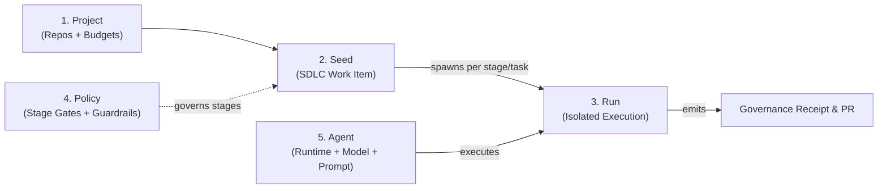

# GitSeed Core Concepts

GitSeed is built around **five core nouns** that model AI-driven software delivery from an initial requirement to a governed, reviewed pull request, supported by a small set of **advanced infrastructure and workspace concepts**.

---

## The 5 Core Nouns

### 1. Project (`prj_...`)
A **Project** is the top-level organizational boundary in GitSeed. It groups one or more Git repositories (single-repo or multi-repo microservice setups), project role-based access control (`viewer`, `developer`, `maintainer`), sandbox and clean-room guardrails (`project.sandbox_config.blocked_paths`), spend guardrails (`monthly_budget`, `seed_budget_cap`, `spend_checkpoint`), concurrency limits (`max_concurrent_runs`), and per-stage policy overrides.

### 2. Seed (`sed_...` or `<project-slug>#<number>`)
A **Seed** is a governed unit of software delivery work—an idea, feature request, bug report, or refactoring objective—that progresses through GitSeed's 5-stage SDLC state machine:

1. **Ideate**: Refines problem context into a structured technical `specification` and verifiable `acceptance_criteria`. Once approved, the specification is locked.
2. **Plan**: Decomposes the locked specification into ordered implementation tasks (`SeedTask`) and identifies target repositories.
3. **Execute**: Checks out a dedicated branch (`gitseed/<project>/seed-<N>`), writes code and tests inside an isolated container, enforces `project.sandbox_config.blocked_paths`, and opens or updates a pull request.
4. **Review**: Audits the branch diff against the locked specification, task checklist, and verification output, producing structured findings and a gate recommendation.
5. **Merge**: Verifies required human approvals and branch readiness before merging the pull request.

For straightforward bugfixes or small changes, operators can create or advance a Seed in **⚡ Fast-Track** mode (`Execute → Review → Merge`), skipping `Ideate` and `Plan` while keeping clean-room `finalize` checks, signed Governance Receipts, and review/merge gates intact. Each Seed also carries an **Autonomy** tier (`manual`, `supervised`, or `autonomous`) that determines whether human stage gates are enforced at every stage or only at designated checkpoints.

### 3. Run (`run_...`)
A **Run** is a single, auditable execution attempt by an **Agent** on a **Seed** (or a specific `SeedTask`) at a given SDLC stage. Every Run records:
- The assigned Agent, CLI runtime adapter, model identifier, and compute backend
- Start/completion timestamps, lifecycle status (`queued`, `starting`, `running`, `succeeded`, `failed`, `cancelled`, `timed_out`), and exit code
- Real-time and persisted stdout/stderr logs, structured stage output, git commit SHA, and verification status
- Token usage (`input_tokens`, `output_tokens`) and USD cost

During `Ideate`, `Plan`, or `Review`, operators can trigger up to three parallel or sequential **multi-opinion Runs** using different agents or models to compare competing specs or independent code reviews side by side.

### 4. Policy (`pol_...`)
A **Policy** defines the stage governance rules for one of the five SDLC stages (`ideate`, `plan`, `execute`, `review`, `merge`). Stage Policies are configured with organization-wide defaults and can be overridden per **Project** (while filesystem path protections like `blocked_paths` are configured on the Project's sandbox/clean-room policy via `project.sandbox_config.blocked_paths`):
- **Assigned Agent (`agent_id`)**: Which Agent handles the stage by default.
- **Autonomy & Stage Gate Approvals**: `requires_approval`, `min_approvers`, `min_approver_role`, `allow_auto_approve`, and `allow_self_approval`.
- **Execution Bounds & Instructions**: `max_attempts`, `timeout_minutes`, `min_acceptance_criteria`, `max_acceptance_criteria`, `max_tasks`, and stage-specific `instructions`.

### 5. Agent (`agt_...`)
An **Agent** is a configured AI persona that executes **Runs** or interactive sessions. Each Agent binds:
- **Handle & Role**: Built-in stage specialists (`@ideator`, `@planner`, `@coder`, `@reviewer`, `@merger`), the workspace assistant (`@coordinator`), or custom operator-defined agents.
- **CLI Runtime**: The underlying coding harness (`opencode`, `claude-code`, `codex`, `antigravity`, `gemini`, `grok-build`).
- **Inference Backend & Model**: Which model provider and model identifier power the agent.
- **System Prompt & Skills**: Role instructions and attached reusable **Skills**.

---

## Advanced & Supporting Concepts

### Workspace (`Sandbox`, `Session`, and `Agent Session`)
**Workspace** is the umbrella concept for interactive, container-backed development environments in GitSeed (exposed in the Web UI's `Workspaces / Sessions` view, the `SessionDock`, the CLI, and MCP). Today, three closely related API resources compose the Workspace experience:

| Concept | ID Prefix | Primary API / MCP Surface | How It Relates |
| :--- | :--- | :--- | :--- |
| **Sandbox** | `sbx_...` | `/api/v1/projects/{id}/sandboxes` (`create_sandbox`, `get_sandbox`, `list_sandboxes`) | An isolated ephemeral container checked out at a repository ref or Seed branch (`gitseed/<project>/seed-<N>`). Runs either a one-shot command (`kind="job"`) or an interactive shell (`kind="terminal"`). |
| **Agent Session** | `ses_...` (`smsg_...` messages) | `/api/v1/projects/{id}/agent-sessions` (`create_agent_session`, `send_agent_session_message`) | A multi-turn conversational coding session with an **Agent** (`@coder`, `@ideator`, etc.) running inside a live workspace container. Operators can steer the agent interactively and promote uncommitted work or drafted specs directly into a governed **Seed**. |
| **Session** | `sbx_...` / `ses_...` | `/api/v1/sessions` (`list_sessions`) | The unified read model that aggregates both terminal **Sandboxes** and interactive **Agent Sessions** across projects, powering the persistent bottom `SessionDock` (Multiplexed PTY Terminal, Agent Chat, and embedded `openvscode-server` / VS Code Web). |

### Backend (`bnd_...`)
A **Backend** is a configured external integration or infrastructure provider managed by administrators:
- **Git Backends (`type="git"`)**: GitHub, GitLab, Bitbucket, or GitSeed's built-in Local Git server (native Git Smart HTTP backed by bare repositories on disk) for repository cloning, branch pushing, webhooks, and pull request creation.
- **Inference Backends (`type="inference"`)**: API-key model providers (routed via LiteLLM with scoped virtual keys and hard budget enforcement) or single-user Personal/Subscription CLI OAuth bundles.
- **Compute Backends (`type="compute"`)**: Local Docker Engine or Kubernetes cluster targets where Runner and Workspace containers execute.
- **Tool Backends (`type="tools"`)**: External MCP servers (`mcp-sse` or `mcp-stdio`) automatically injected into agent containers during Runs.

### Skill (`skl_...`)
A **Skill** is a reusable, versioned Markdown instruction module (coding conventions, testing playbooks, framework guidelines, or security checklists) that can be attached to one or more **Agents** and injected into their context during **Runs** and **Agent Sessions**.

### Governance Receipt
A **Governance Receipt** (`gitseed.receipt.v1`) is the Ed25519-signed auditable provenance record produced as a **Seed** moves from `Ideate` through `Merge`. Compiled from the Seed's locked specification, task plan, server-verified `run.output["trusted"]` **Run** telemetry (models, agents, `enforced` vs. `estimated` token spend, diff/secret-scan checks, and `project.sandbox_config.blocked_paths` enforcement), and stage-gate approval records (`Approval` + `Activity` audit events), it provides reviewers and compliance teams with end-to-end attestation of *what* was built, *which* agents and models touched the code, *how* it was verified, and *who* approved each stage gate—verifiable offline via `gitseed receipt verify --public-key-file`.
